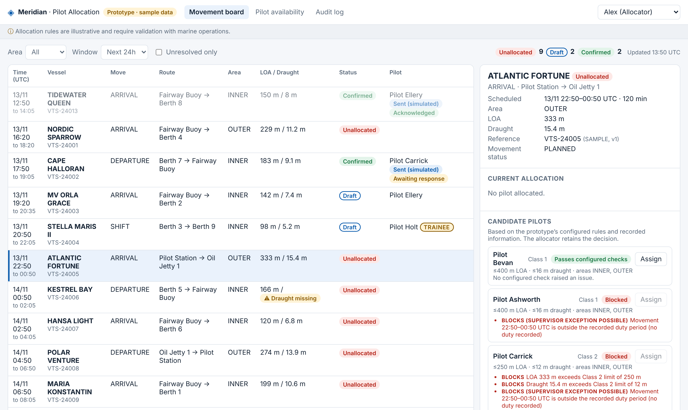

# Meridian — Pilot Allocation MVP

First Meridian component: a shared workspace where authorised marine operations staff view movements that need a pilot, review pilot availability and suitability, assign pilots and manage changes, with a full audit trail.

> **Allocation rules are illustrative and require validation with marine operations.** See the [illustrative rules register](docs/illustrative-rules.md).
>
> **Status: discovery prototype.** Built to validate the workflow with allocators using realistic scenarios before delivery scope is agreed. All allocation rules, roles and thresholds are **proposed placeholders** (see [open decisions](docs/open-decisions.md)). Sample data is fictional. Technology and hosting choices remain subject to architecture review ([ADR-0001](docs/adr/0001-discovery-prototype-stack.md)).



## Quick start

Requires Node.js 22.13 or later. No dependencies to install.

```bash
npm start            # http://localhost:3000, in-memory sample data (resets on restart)
npm test             # 34 tests: acceptance criteria plus the full discovery walkthrough
```

Persistent local data:

```bash
npm run seed -- meridian.db && MERIDIAN_DB=meridian.db npm start
```

Use the user picker (top right) to switch role: **Alex / Blair** (allocators), **Sam** (supervisor), **Olly** (operational colleague, read-only).

## What it does

| Epic acceptance criterion | Prototype behaviour |
|---|---|
| 1. Movement visibility | Movement board filtered by area, time window and unresolved status, with allocation status |
| 2. Pilot information | Candidate list per movement: passes configured checks / warnings / draft only / needs exception / blocked, with reasons. Missing data (for example "Draught missing") is flagged and prevents confirmation. Trainees are marked |
| 3. Allocation | Config-driven checks: blocking, warnings (must be accepted), authorised exceptions (role + reason) |
| 4. Change handling | Movement time/detail changes, movement cancellation, pilot unavailability and pilot decline flag affected allocations for review |
| 5. Reallocation and cancellation | Reason + category required; previous allocation kept as `SUPERSEDED` / `CANCELLED` and linked |
| 6. Concurrent working | Optimistic version checks on every write; database enforces one active allocation per movement |
| 7. Status and communication | Draft, confirmed and requires-review are visually distinct. Notification and pilot response are separate, simulated states |
| 8. Auditability | Readable history (vessel, reference, actor, UTC time, before → after, reason) with technical detail on expand. Prototype record only, not tamper-proof |
| 9. Access | Role-based permissions (viewer, allocator, supervisor) |
| 10. Operational validation | Scripted scenarios in [docs/validation-scenarios.md](docs/validation-scenarios.md) |

Also included: a dated, UTC pilot availability timeline showing transit allowances, tactical CSV movement import with reconciliation report, pilot availability timeline, and proposed metrics (time to allocate, unallocated, rework by reason, adoption, exceptions).

## Structure

```
src/
  config/rules.json   Illustrative rule values, severities and exception authority (see docs/illustrative-rules.md)
  rules.js            Allocation checks
  service.js          Workflow, permissions, change handling, audit, import, metrics
  roles.js            Role → permission map
  db.js               SQLite schema (node:sqlite), append-only audit triggers
  server.js           HTTP API + static UI
  seed.js             Fictional sample data, relative to current time
public/               Allocator workspace (vanilla JS, no build step)
test/                 Acceptance-criteria tests (node:test)
docs/                 Epic, backlog, decisions, validation scenarios, ADRs
```

## Not production-ready

- Identity is a stub (`x-meridian-user` header). Replace with the agreed identity service (D-08).
- Movement and pilot data are sample or CSV-imported. Integration sources are not agreed (D-04, D-05).
- No hosting, monitoring, backup or support arrangements (D-10, D-11).

## Docs

- [Epic](docs/epic.md)
- [Backlog and traceability](docs/backlog.md)
- [Open decisions](docs/open-decisions.md)
- [Illustrative rules register](docs/illustrative-rules.md)
- [Discovery walkthrough guide](docs/walkthrough-guide.md)
- [Validation scenarios](docs/validation-scenarios.md)
- [API](docs/api.md)
